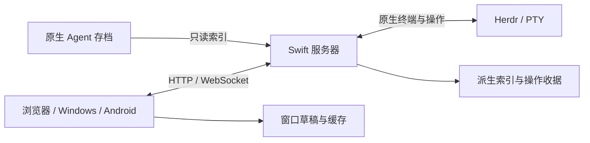

# 架构

## 组件与状态归属

Swift 由服务器与客户端组成。服务器连接 Herdr 管理的真实终端，读取原生 Agent 存档并提供 HTTP/WebSocket；浏览器、Windows 和 Android 客户端共享业务界面与协议。

| 数据                               | 事实来源                                   |
| ---------------------------------- | ------------------------------------------ |
| PTY、拓扑、终端身份和键盘模式      | Herdr 与操作系统。                         |
| 消息、工具结果和有效会话历史       | 原生工具维护的存档；临时线程来自原生进程。 |
| 投递请求、收据与同步事件           | Swift 按根目录隔离的业务 SQLite。          |
| 正文副本、阅读位置、草稿和展示模式 | 客户端的派生缓存与各窗口本地状态。         |
| 直连 token 和服务器配置            | 私有配置；客户端凭据库或应用私有存储。     |

## 服务器

`server.js` 装配设置、根目录上下文、原生适配、路由与订阅。`lib/http/` 处理认证、响应、静态资源和按领域划分的路由。业务模块负责会话身份、投递、原生操作、文件和服务器更新，不由页面自行拼接原生命令。

`lib/providers/` 将不同原生存档投影成共享消息模型。结构化索引和大文件解析在有界工作线程中进行，缓存按文件版本复用。`lib/store/` 保存投递与操作结果，`lib/sync/` 生成快照和增量；根目录切换不改变已在处理请求绑定的数据范围。

认证区分真实回环、明确识别的本机 WSL 宿主和其他来源，不信任转发头或整个私有地址段。`lib/http/server-token.js` 保存持久 token，`lib/server-info.js` 生成连接摘要。`bin/swift.js` 提供连接摘要和原生终端命令。

## 客户端

`public/` 提供共用业务界面。`core/` 管理请求、连接和同步副本，`chat/` 管理消息、终端、输入与会话操作，`renderers/` 按提供方渲染，`files/` 管理工作区文件，`nav/` 管理导航与手势。文件源码视图按需加载 CodeMirror 6，预览与聊天首屏不加载编辑器模块；编辑状态与历史归文件标签，保存仅更新已提交快照的基线。

Windows 的 Rust 核心保存直连记录和系统凭据，通过稳定的本机网关向 WebView2 提供资源及业务连接。Tauri 外壳管理窗口、单进程与更新。`desktop/ui/` 提供本地连接管理，业务页面由 `public/` 生成，不复制另一套渲染器。

Android 会话版是 WebView 外壳；原生终端版独立渲染终端。两者共享 `src/connection`，不同 flavor 不互相引用。带 token 链接在连接边界解析，普通地址与凭据分开保存。

## 终端与实时路径

共享终端使用协商的单元格快照、增量与有界历史。控制与观察分开，每流独立确认、限制积压并处理慢消费者。旧能力使用协议约定的兼容路径，不依版本字符串猜测能力。

已打开且身份未变的终端从本地状态立即显示；后台更新但不绘制。明确原生操作才取得焦点或尺寸。存档、目录、统计、工具详情与预览均不得成为输入或切换的前置条件。完整约束及验证矩阵见[共享运行时约束](SHARED_RUNTIME_ARCHITECTURE.md)。

## 安装与分发

`deploy/` 管理项目内配置、服务模板与安装。`runtime/` 保存原生扩展的固定来源、补丁、构建和升级入口。开发脚本按构建、检查、测试和发行分组，职责见[目录说明](development/structure.md)。

服务器源码包从受 Git 跟踪的发行输入生成，不收集本地配置、依赖和测试产物。Windows 更新使用独立签名和配置的静态更新通道；公开下载通道不参与会话连接。原生运行包升级只影响新进程入口，保留已有会话、旧产物与回退。

## Windows 启动

窗口先恢复几何状态和主题背景，再在独立线程初始化 WebView2。首屏使用安装包内资源；系统凭据和网络按实际访问的服务器延迟恢复，不等待其他已保存连接。资源版本覆盖全部前端输入，桌面经典脚本压缩后仍保留共享全局接口。
