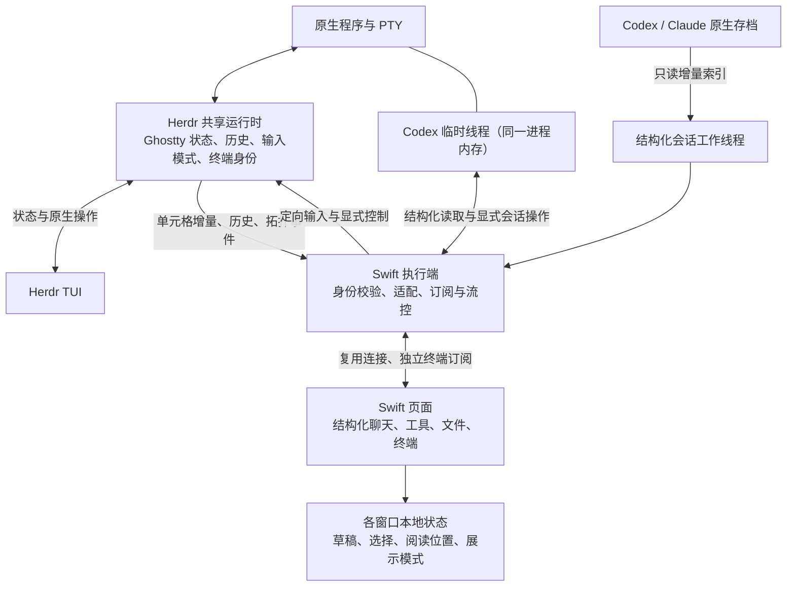

# 共享终端架构与性能约束

本文维护 Swift 共享运行时的开发约束，适用于终端、结构化聊天、工具、文件、同步、客户端及 Herdr 扩展。新增功能、重构和依赖升级都必须保持这些边界。产品行为见 [PRODUCT_SPEC.md](PRODUCT_SPEC.md)，全系统架构见 [ARCHITECTURE.md](ARCHITECTURE.md)，验证入口见 [VALIDATION.md](VALIDATION.md)。本文维护长期约束；版本和实验结果应绑定对应的源码与验证记录。

## 1. 架构与状态归属

Swift 保留结构化界面与定制功能，Herdr 管理真实终端运行时。Herdr TUI 和 Swift 操作同一个 PTY，终端状态由同一个 Ghostty 实例解析。Codex／Claude 的结构化存档仍由原工具维护，不能用终端画面替代完整会话数据。

| 状态                                                                                                         | 唯一事实来源与扩展位置                                                               |
| ------------------------------------------------------------------------------------------------------------ | ------------------------------------------------------------------------------------ |
| PTY、终端单元格、光标、输入模式和真实滚动历史由 Herdr／Ghostty 维护。                                        | 新的共享终端能力应扩展运行时 API／能力协商，Swift 保存可失效的投影与缓存。           |
| Workspace、Tab、Pane、Terminal 身份与拓扑由 Herdr 维护。                                                     | Swift 调用原生操作并消费事件，不按标题、目录、列表位置创建第二套身份或拓扑。         |
| 消息、工具结果及提供方会话归属来自经过身份校验的原生存档；不存档的临时会话来自同一原生进程的结构化内存接口。 | 提供方适配器和增量索引负责读取；存档只读，UI 不能根据 PTY 输入回显伪造已提交消息。   |
| 草稿、当前选择、阅读位置和展示模式属于各窗口。                                                               | 新功能使用窗口本地状态；共享会话变化不等于所有窗口必须同时切页、滚动或清草稿。       |
| Swift 特有的展示和派生状态属于 Swift。                                                                       | 可以新增业务功能，但必须绑定实际会话身份，说明失效条件，不能反过来冒充原生终端事实。 |

“两端同步”表示对同一原生会话的操作及结果一致，不表示所有客户端共享焦点、尺寸、阅读位置或草稿。选择缓存页是本地动作；是否申请原生控制由明确的输入语义决定。

## 2. 三条关键路径

### 终端输出与切换

运行时按内容版本提供单元格快照／增量，Swift 执行端按订阅发送，浏览器校验并更新本地状态，当前可见终端再绘制。`cells-v1` 路径不创建隐藏 xterm 来重复解析 Herdr 的整屏重绘 ANSI；可见 xterm 仍消费由原生单元格生成的行差异，并非完全取消 ANSI 编码或解析。

ANSI 兼容路径保留原生同步输出边界（DEC 模式 2026）。分块数据继续逐块解析和确认，结束标记到达前不绘制中间画面或据此读取历史，避免完整重绘尚未接收完毕时改变可见行的位置。

已经打开、身份未变且仍在缓存中的终端，切换时先显示本地状态。后台更新状态但停止绘制，不因不可见停止消费；切回不得重新连接、重建终端、补完历史、等待存档或网络确认后才显示。首次打开、缓存淘汰和连接中断是单独的状态，不能冒充缓存命中。

### 原生输入与尺寸

浏览器按键通过语义输入交给 Herdr／Ghostty，按实际键盘模式编码。输入法提交和粘贴保留原始文本路径。控制连接与观察连接的职责分开，支持无绘制控制就绪；不能等待 ANSI 首帧或历史读取完成后才允许输入。

只有明确的原生操作才申请控制。观察、预热、DOM 聚焦、后台事件和重连不取得尺寸；前台实际操作后保持尺寸，失焦、隐藏、离开终端或断连时释放。普通本地历史滚动不申请远端尺寸；应用接管鼠标或备用屏幕下的滚动按原生语义转发。不得通过向所有后台终端发送 resize 来“同步显示”。

### 结构化聊天与附加功能

原生存档通知触发增量读取，工作线程维护索引，前端按消息身份及历史代次合并。冷索引、目录扫描、工具详情、文件预览、搜索和统计不得成为切换、输入或实时终端输出的前置条件。已有数据先显示，缺失内容按需加载；新增后台工作要有并发上限、取消和过期结果校验。

同步握手优先发送客户端正在查看的会话，其余会话继续按版本追平。支持解压的客户端可协商 gzip；4 KiB 至 4 MiB 的同步 JSON 在压缩后更小时使用 gzip 与 Base64 文本封装，使其经过不支持 WebSocket 压缩扩展的原生网关仍保持压缩。服务端逐条异步压缩，积压预算按原始字节计算；客户端只按顺序解压同步事件，终端数据不等待这条队列。断连和重新握手丢弃迟到结果，解压失败取消该能力并重新只读追平，旧客户端仍使用普通 JSON。HTTP 网关同时转发压缩协商与响应编码，不分离编码头和对应正文。

## 3. 必须保持的约束

| 约束                             | 实现和评审时必须核对的行为                                                                                                                                         |
| -------------------------------- | ------------------------------------------------------------------------------------------------------------------------------------------------------------------ |
| 缓存切换不依赖网络。             | 不把 RPC、历史补齐、文件扫描、全量索引或动画结束放入切换完成条件。前端装饰不能禁用已就绪的输入。                                                                   |
| 后台只更新必要状态。             | 隐藏终端不绘制，未变化的状态不重建 DOM／终端／绘制资源。终端订阅仅服务已打开且仍保留的终端，不把所有已发现会话都永久挂载。                                         |
| 各终端独立限制输出积压。         | 保持每流确认、限额、超时和公平调度；后台刷屏或慢消费者不得阻塞其他终端的输入。历史和新增终端消息也受相应额度约束。                                                 |
| 输入不重放。                     | 输入排队有界，绑定运行实例、终端及当前选择；异步等待前后复核身份和选择。断连或结果不确定时不得自动重发文本、按键、粘贴或中断。结构化操作沿用其请求 ID 和收据机制。 |
| 状态增量必须校验基线。           | 保留运行实例、终端、revision、base_revision 和历史代次校验。过期或不连续数据不能强行合并；需要时重新取得快照，不清空用户草稿或重放操作。                           |
| 历史属于本地阅读视图。           | 缓存内滚动不等待远端；缺页通过有界分页取得。裁剪、resize／reflow 和历史代次变化必须处理，不能将旧行拼接到新终端或新布局。                                          |
| 一个窗口不能控制其他窗口的展示。 | 不能把本地选择、阅读偏移或展示模式广播成全局命令；共享操作只同步实际原生结果。                                                                                     |
| 昂贵工作退出交互关键路径。       | 不在按键、逐字节解析、每帧绘制或 Pane 遍历中扫描进程树、读文件、解析完整存档或重复生成快照。后台队列、缓存和 worker 数量均须有界。                                 |
| 通知优先，轮询只作回退。         | 新状态尽量接入现有事件／文件通知和去重机制，不为每个组件增加固定频率轮询，也不把更大的 debounce 当作解决负载的方法。                                               |
| 兼容通过能力协商实现。           | 保留旧客户端／运行时的 ANSI 路径；新字段、输入语义和方法必须先协商。不能在协议号不变时修改冻结二进制编解码布局，或仅用版本字符串猜测能力。                         |

原生内容锁内只做必要的状态访问。快照应按内容版本共享；序列化、网络写入和文件 I/O 不延长终端核心锁。新增字段应使用窄范围访问器，不能为一个标量收集全部输入状态或终端历史。

每次向高频路径增加工作，必须说明其频率和数量：每字节／事件／帧的成本，如何随 Pane 数、客户端数、历史长度和输出量增长。一个终端上看不出的开销，可能在 64 个终端和多窗口中成倍增加。

## 4. 新功能如何接入

| 新功能类型                                                                 | 推荐的接入方式                                                                       | 必须避免的退化                                                                           |
| -------------------------------------------------------------------------- | ------------------------------------------------------------------------------------ | ---------------------------------------------------------------------------------------- |
| 新增状态栏字段、任务提示或徽标时，应使用已有状态投影或异步元数据。         | 仅变化字段更新视图；缺失数据不阻塞输入。                                             | 不在每次绘制时发原生命令、扫描进程或重新解析全量存档。                                   |
| 新增工具摘要、文件差异或预览时，应在结构化展示与详情读取层实现。           | 列表保留轻量摘要，展开后读取重内容，离开时取消，迟到结果验证所属会话。               | 不把完整工具输出或大文件塞入每个会话快照，也不在终端线程格式化。                         |
| 新增终端／消息搜索、导出、统计或 AI 摘要时，应使用只读数据与独立有界任务。 | 根据数据来源选择历史分页或存档索引，限制扫描范围与并发，优先服务当前交互。           | 不借输入通道采集内容，不无限保留所有终端帧，不让批量扫描占用实时输出队列。               |
| 新增提供方或会话操作时，应扩展提供方适配、原生身份校验与操作收据。         | 使用同一真实会话，区分观察与写入，处理旧身份、未就绪和结果不确定。                   | 不以标签／目录猜目标，不创建第二个 PTY 或第二套原生运行状态来冒充同步。                  |
| 新增快捷键、触摸组合键、粘贴或鼠标功能时，应复用原生输入通道。             | 区分语义按键、IME 提交、文本粘贴和本地快捷键，核对实际 PTY 字节与目标身份。          | 不复制一套键盘模式判断，不绕过控制与选择校验，不让重试产生重复输入。                     |
| 新增多窗口、分组、标签或远端连接时，应复用拓扑 API 与订阅管理。            | 本地展示状态独立；连接断开后恢复观察，身份变化后丢弃旧绑定。                         | 不用窗口聚焦抢原生尺寸，不让一个服务端故障重连所有服务端，不在切换时重新登录或创建会话。 |
| 新增主题、字体、动画或绘制后端时，应在展示层实现。                         | 只让受影响的缓存失效，保持终端实例、选区、光标、宽字符和阅读位置；支持减少动态效果。 | 不因主题／偏好事件重建全部终端，不先播放遮罩动画再开放输入，不为截图平滑阻塞输出。       |
| 新增录制、共享观察或终端元数据时，应在运行时／服务订阅层实现。             | 观察无尺寸副作用，单独限制消费者积压；新的共享事实使用中立 API 名称并协商能力。      | 不让观察者成为控制者，不在终端锁内执行存储或网络广播，不把客户端布局状态写入运行时。     |

这些是扩展原则，不是新增产品功能的授权。新产品行为仍遵守用户需求和产品规范；不能借扩展功能取消现有性能与身份约束。

## 5. 代码入口与资源预算

| 职责                                                  | 当前入口                                                                                                                                                                                                   |
| ----------------------------------------------------- | ---------------------------------------------------------------------------------------------------------------------------------------------------------------------------------------------------------- |
| 原生能力、状态和历史适配位于运行时与 Swift 服务边界。 | [运行包入口](../runtime/herdr/README.md)、[状态订阅](../lib/herdr-terminal-state.js)、[终端接入](../lib/shell-terminal.js)。                                                                               |
| 多路传输和输出确认负责公平调度与积压限制。            | [服务端复用](../lib/terminal-multiplexer.js)、[输出控制](../lib/output-control.js)、[消费窗口](../lib/output-window.js)、[客户端通道](../public/chat/terminal-channel.js)。                                |
| 本地状态、历史和终端交互负责客户端连续性。            | [状态校验](../public/chat/terminal-state.js)、[单元格投影](../public/chat/terminal-state-renderer.js)、[终端生命周期](../public/chat/shell-terminal.js)、[键盘语义](../public/chat/terminal-keyboard.js)。 |
| 结构化数据与同步负责增量读取和按需更新。              | [会话索引](../lib/conversation-index.js)、[工作线程入口](../lib/archive-worker-client.js)、[存档通知](../lib/transcript-watcher.js)、[SyncHub](../lib/sync/hub.js)。                                       |
| 构建与迁移负责运行包来源和原生会话保全。              | [固定来源](../runtime/herdr/source.json)、[迁移](../runtime/herdr/migrate.py)、[受管安装](../deploy/herdr/install.py)。                                                                                    |

0.16.0 的输出窗口高水位为 256 KiB、低水位为 64 KiB、硬上限为 1 MiB，消费停滞限制为 2 秒；多路发送按 16 KiB 分块，共享发送积压达到 128 KiB 时暂停继续排出。数值的当前实现以对应源码为准，不能把这些值误解为可接受的交互延迟。

预算可以根据同条件测量调整，不能仅扩大队列、超时或缓存来掩盖缺失确认、无限生成和泄漏。修改预算时同时记录峰值内存、待处理字节、吞吐和前台输入延迟；缓存淘汰必须释放订阅和监听，并正确区分下次冷打开与缓存命中。

## 6. 改动与验证的对应关系

先说明受影响的状态归属、关键路径、资源预算和兼容分支，再选验证入口。只改文档或不影响关键路径的简单样式，不要求运行所有性能测试；涉及高频路径、并发规模、协议、缓存生命周期或流控时，不能只交单元测试或截图。

| 修改范围                                                           | 必须覆盖的行为与现有入口                                                                                                                                                                                                                                  |
| ------------------------------------------------------------------ | --------------------------------------------------------------------------------------------------------------------------------------------------------------------------------------------------------------------------------------------------------- |
| 改动单元格、历史、键盘或终端生命周期时，应同时验证原生状态和前端。 | 使用 `test/terminal-state-renderer.test.js`、`test/terminal-keyboard.test.js`、`test/herdr-terminal-state.test.js` 及隔离真实 PTY；状态入口为 `scripts/testing/herdr-runtime-state-probe.js`，传入明确候选二进制绝对路径。需要记录实际协商到 `cells-v1`。 |
| 改动多路连接、确认或背压时，应验证单流停滞与后台刷屏。             | 使用 `test/terminal-multiplexer.test.js`、`test/terminal-channel.test.js` 和 `npm run validate -- persistent-terminals`；再按实际改动验证共享运行时，旧 ANSI 用例不能替代新路径。                                                                         |
| 改动展示状态、聊天索引或同步时，应验证数据和窗口隔离。             | 使用 `harness:recovery`、`harness:providers`，按影响选择 `presentation-mode`、`long-session`、`chat-fluidity`、`desktop`；包括追加、分页、重连、旧结果丢弃和多窗口阅读位置。                                                                              |
| 改动原生解析、快照、锁、广播、渲染或 Pane 遍历时，应验证规模增长。 | 按 Herdr 的 `AGENTS.md` 运行原生检查与渲染规模测试，至少比较 1／15 个终端；影响多路终端时扩大到 64 个，包含后台刷屏。CPU 对照可用 `scripts/testing/herdr-runtime-release-benchmark.py`，参数见该脚本。                                                    |
| 改动迁移、协议或安装时，应先验证失败及兼容路径。                   | 使用 `scripts/testing/herdr-runtime-handoff-probe.py --full-state` 并显式传入源／候选二进制和输出目录；核对身份、PTY PID、完整状态及失败不重放，再按 [验证流程](VALIDATION.md) 运行安装与客户端回归。                                                     |
| 改动 Windows／手机交互时，应明确平台证据。                         | Windows 在隔离虚拟机中运行；用 `SWIFT_WINDOWS_RUNTIME_BIN` 指定候选执行 `npm run validate -- desktop windows` 才覆盖真实共享 PTY。浏览器合成触摸和 Unicode 注入不等于物理手机 IME 验收。                                                                  |

`npm run validate -- fast` 是基础检查入口，不能代替上表的相关行为。完整命令、环境保护和产物绑定遵循 [VALIDATION.md](VALIDATION.md)。测试脚本可能默认使用官方 `herdr` 或 ANSI 夹具，必须核对二进制、协商格式与报告，不能因为测试名称包含 terminal 就认定覆盖了共享运行时。

### 性能比较与验收

- 将缓存切换、冷打开、控制就绪、输入到 PTY、可见回显和断线恢复分别计时。缓存命中切换的目标是在一个显示刷新周期内完成，且不等待网络；这个结构性约束不能用平均值掩盖。
- 在同一机器、构建类型、终端数量、几何、历史规模、客户端数量和网络条件下比较修改前后。原生 CPU／输入基线与 Swift 的额外开销分别报告，至少记录样本数、p50／p95／最大值；关键路径还要检查主线程停顿、队列、CPU 和内存。
- 网络相关变化应覆盖本地及受控 50／150 ms RTT，并验证断流、恢复和输入不重放。面向真实远端的问题，还需核对实际客户端、执行端和连接路线，不能把模拟 RTT 当作生产证据。
- 发现可重复的明显退化、跨终端阻塞或资源无界增长时，必须先修复、撤回相关改动，或将新功能移出关键路径，不能仅更新基准数字、放宽超时或宣称“主观流畅”。需要改变架构约束的方案必须明确提出取舍和新预算，并同步本文及对应验证，不能在无说明的重构中改变默认行为。

## 7. 协议、升级与交付

能力协商、原生身份和旧协议回退属于架构的一部分。状态观察能力为 `terminal_state_version`，语义按键能力为 `terminal_input_version`；不要把所有新功能捆绑成一个强制升级判断。更换绘制器、输入方式或传输格式仍须保留旧版本可用的分支，未知结果不按成功处理。

运行时升级先在独立 HOME／socket／PTY 中验证，生产会话不接收测试输入。迁移核对 Pane ID、Terminal ID、PTY PID 和进程启动时间；固定上游提交、补丁、构建与包哈希，不覆盖官方二进制或官方渠道。旧版 0.9.3 无完整快照导出，首次迁移不能承诺所有历史无损；旧 TUI 会断开并需重新连接。新扩展之间的快照保全不能套用到旧版。

客户端与执行端可能分别更新。Android 会话壳加载执行端页面，独立原生终端 App 是另一实现；修改后端页面不等于修改了所有客户端。构建、模拟、真实运行、安装、上线和用户反馈分别记录，源码在构建／验收期间必须固定。部署范围继续以当前 `AGENTS.md` 和用户授权为准。

## 8. 提交前的简短说明

涉及上述边界的改动，在任务记录或提交说明中回答以下问题；普通小改动用几句话即可，无需新建管理层级。

1. 新增状态由谁维护，如何绑定实际会话，何时失效？
2. 新工作在哪条路径运行，成本如何随终端、客户端和历史规模增长？
3. 缓存切换、原生输入及后台终端是否新增等待、绘制或资源占用？
4. 队列、缓存、并发和取消有哪些边界，慢消费者及断线会怎样处理？
5. 哪些行为、兼容分支和性能对照已经验证，哪些仍未验证？

评审依据应是这些问题的实现和证据。文档用于约束开发，不能替代自动化行为测试和必要的真实运行对照。
